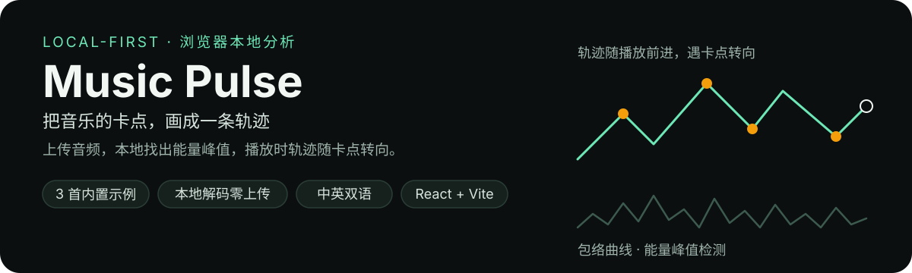
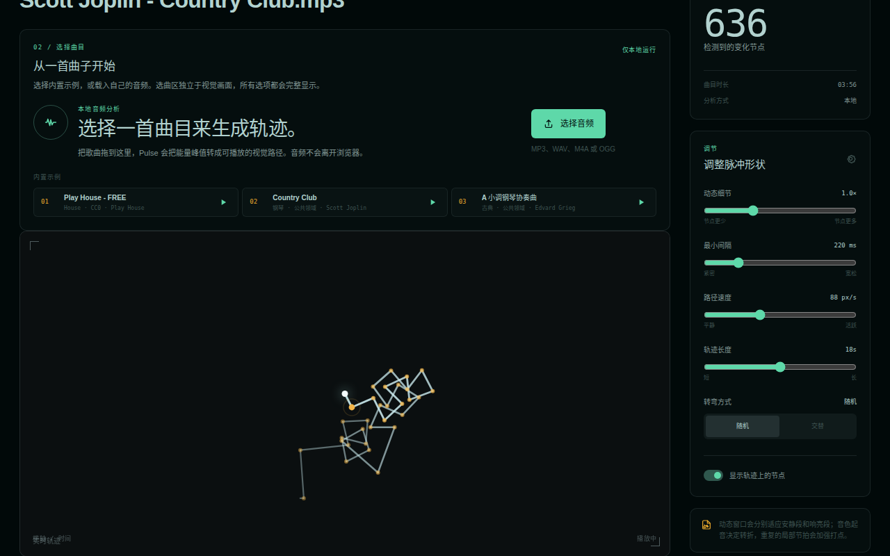
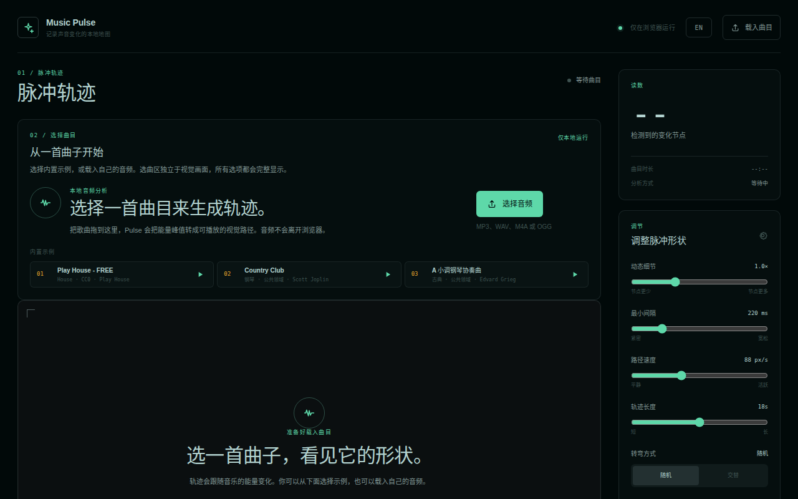

<p align="right"><a href="README.md">中文</a></p>

<p align="center">
  
</p>

<p align="center">
  <a href="https://xiaosang.cc/music-pulse/">▶ Try Online</a>
  ·
  <a href="https://github.com/holynova/music_pulse">GitHub Repository</a>
</p>

Music Pulse is a local-first browser visualizer for music: drop in a track and it decodes the audio with the Web Audio API, finds energy peaks ("pulse moments"), and turns them into a playable path. The path advances with the music and changes direction at every pulse moment, which is also marked on a seekable timeline. Audio never leaves the browser — no account, API key, or server needed. Chinese/English UI.

## Screenshots

<p align="center">
  
  
</p>

## How It Works

1. **Decode**: the selected file is decoded locally with the Web Audio API.
2. **Envelope**: the music's energy is sampled into a short-time envelope curve.
3. **Peak detection**: adaptive thresholds + local peaks + a minimum gap produce the pulse markers.
4. **Trajectory**: the pulse timestamps generate a deterministic path (the same track with the same settings always yields the same path).
5. **Sync**: the canvas and timeline follow `HTMLAudioElement.currentTime`, so pause, seek, and replay stay aligned.

The detector finds prominent onsets and energy changes — it is intentionally not a BPM or bar inference engine. Sensitivity and minimum gap are both adjustable to suit different kinds of music.

## Controls

| Parameter | Default | Notes |
|---|---|---|
| 动态感知 (Sensitivity) | 1.0× | Higher values detect more pulse moments |
| 最小间隔 (Minimum gap) | 220 ms | Shortest interval between two pulse moments |
| 路径速度 (Path speed) | 88 px/s | How fast the path advances |
| 轨迹长度 (Trail length) | 18 s | How much of the path stays visible on the canvas |
| 转弯方式 (Turn style) | 随机 (Random) | Random turns / alternating turns |
| 显示节点 (Show markers) | On | Whether pulse moments are shown on the path |

Measured with defaults: Scott Joplin's *Country Club* (03:56) yields **636 pulse moments**.

## Included Demo Tracks

The empty state offers three one-click demo tracks, covering three of the most useful listening types (sources, licenses and file hashes in `public/audio/README.md`):

| Track | Artist | Length | License |
|---|---|---|---|
| Play House - FREE | Play House | 04:42 | CC0 1.0 |
| Country Club | Scott Joplin (performed by James Brigham) | 03:56 | Public domain |
| Piano Concerto in A minor | Edvard Grieg | 12:35 | Public domain (released by Musopen) |

The bundled files are locally re-encoded 160 kbps MP3 demo versions. Uploads accept MP3, WAV, M4A, AAC, OGG, FLAC, WebM.

## Run Locally

```bash
pnpm install
pnpm dev
```

Open the local address Vite prints. Audio is decoded and analyzed inside the browser — nothing is uploaded.

```bash
pnpm test    # Vitest: beat detection and trajectory tests (11 cases)
pnpm lint    # ESLint
pnpm build   # TypeScript + production build
```

## Tech

- React 19 + Vite + TypeScript + Tailwind CSS.
- Beat detection (`src/lib/beatDetection.ts`): envelope sampling, adaptive thresholds, local peaks, minimum gap.
- Trajectory generation (`src/lib/trajectory.ts`): deterministic paths, random or alternating turns.
- Rendering: Canvas path (`PulseCanvas`) + timeline (`Timeline`), following the audio clock.
- Chinese/English copy (`src/lib/i18n.ts`), Chinese by default.

```
index.html                  Entry (title Music Pulse, dark theme)
src/App.tsx                 Main UI: track selection, analysis session, playback controls
src/components/PulseCanvas.tsx   Path canvas
src/components/Timeline.tsx      Pulse timeline
src/components/ControlDock.tsx   Playback control bar
src/components/SettingsPanel.tsx Settings panel
src/components/UploadPanel.tsx   Upload panel + built-in demos
src/hooks/useAudioSession.ts     Audio session: decoding and analysis state
src/lib/beatDetection.ts         Energy peak detection
src/lib/trajectory.ts            Deterministic trajectory generation
src/lib/i18n.ts                  Chinese/English copy
public/audio/                    3 built-in demo tracks (CC0 / public domain)
```
