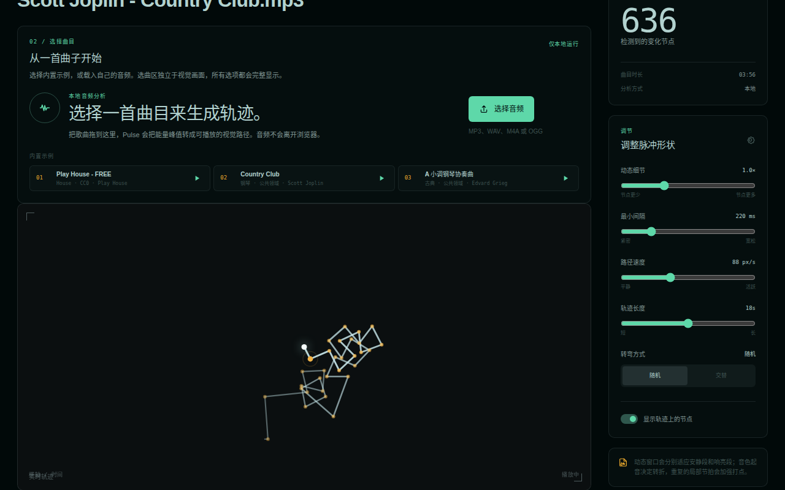

<p align="center">
  
</p>

<p align="center">
  <a href="https://xiaosang.cc/music-pulse/">▶ 在线体验 Try Online</a>
  ·
  <a href="https://github.com/holynova/music_pulse">GitHub 仓库</a>
</p>

Music Pulse 是一个本地优先的浏览器音乐可视化工具：上传一首歌，它用 Web Audio API 在浏览器里解码并找出能量峰值（卡点），生成一条可播放的轨迹——轨迹随音乐前进，遇到卡点就转向，卡点同时标在可拖动的时间轴上。音频不离开浏览器，无需账号、API Key 或服务器。中英双语。

Music Pulse is a local-first browser visualizer for music: drop in a track and it decodes the audio with the Web Audio API, finds energy peaks ("pulse moments"), and turns them into a playable path. The path advances with the music and changes direction at every pulse moment, which is also marked on a seekable timeline. Audio never leaves the browser — no account, API key, or server needed. Chinese/English UI.

## 截图 / Screenshots

<p align="center">
  
  
</p>

## 它怎么工作 / How It Works

1. **解码**：选中的文件用 Web Audio API 在本地解码。
2. **包络**：音乐能量采样为短时包络曲线。
3. **检峰**：自适应阈值 + 局部峰值 + 最小间隔，得到卡点标记。
4. **轨迹**：卡点时间戳生成确定性轨迹（同一设置下同一首歌的轨迹不变）。
5. **同步**：画布与时间轴跟随 `HTMLAudioElement.currentTime`，暂停、拖动、重播都保持对齐。

检测器找的是显著的起音与能量变化，它不是 BPM 或小节推断引擎——灵敏度与最小间隔都开放调节，以适应不同类型的曲目。

## 调节 / Controls

| 参数 | 默认值 | 说明 |
|---|---|---|
| 动态感知（灵敏度） | 1.0× | 越高检出的卡点越多 |
| 最小间隔 | 220 ms | 两个卡点之间的最短间隔 |
| 路径速度 | 88 px/s | 轨迹前进的速度 |
| 轨迹长度 | 18 s | 画布上保留的轨迹时长 |
| 转弯方式 | 随机 | 随机转向 / 交替转向 |
| 显示节点 | 开 | 是否在轨迹上显示卡点 |

实测（默认设置）：Scott Joplin《Country Club》（03:56）检出 **636 个变化节点**。

## 内置示例 / Included Demo Tracks

空状态提供三首一键试听的示例曲，覆盖三种最有用的听感类型（来源、许可与文件哈希见 `public/audio/README.md`）：

| 曲目 | 艺术家 | 时长 | 许可 |
|---|---|---|---|
| Play House - FREE | Play House | 04:42 | CC0 1.0 |
| Country Club | Scott Joplin（James Brigham 演奏） | 03:56 | 公共领域 |
| Piano Concerto in A minor | Edvard Grieg | 12:35 | 公共领域（Musopen 发布） |

内置文件是本地重编码的 160 kbps MP3 演示版本。自己上传支持 MP3、WAV、M4A、AAC、OGG、FLAC、WebM。

## 本地运行 / Run Locally

```bash
pnpm install
pnpm dev
```

打开 Vite 打印的本地地址即可。音频在浏览器内解码与分析，不上传。

```bash
pnpm test    # Vitest：节拍检测与轨迹测试（11 个用例）
pnpm lint    # ESLint
pnpm build   # TypeScript + 生产构建
```

## 技术 / Tech

- React 19 + Vite + TypeScript + Tailwind CSS。
- 节拍检测（`src/lib/beatDetection.ts`）：包络采样、自适应阈值、局部峰值、最小间隔。
- 轨迹生成（`src/lib/trajectory.ts`）：确定性路径，随机 / 交替两种转弯方式。
- 渲染：Canvas 轨迹（`PulseCanvas`）+ 时间轴（`Timeline`），跟随音频时钟。
- 中英双语文案（`src/lib/i18n.ts`），默认中文。

```
index.html                  入口（标题 Music Pulse，深色主题）
src/App.tsx                 主界面：曲目选择、分析会话、播放控制
src/components/PulseCanvas.tsx   轨迹画布
src/components/Timeline.tsx      卡点时间轴
src/components/ControlDock.tsx   播放控制条
src/components/SettingsPanel.tsx 调节面板
src/components/UploadPanel.tsx   上传面板 + 内置示例
src/hooks/useAudioSession.ts     音频会话：解码与分析状态
src/lib/beatDetection.ts         能量峰值检测
src/lib/trajectory.ts            确定性轨迹生成
src/lib/i18n.ts                  中英双语文案
public/audio/                    3 首内置示例曲（CC0 / 公共领域）
```

## English

**Music Pulse** is a local-first browser visualizer: upload a track and it decodes the audio in the browser (Web Audio API), detects energy peaks, and draws a playable path that advances with the music and turns at every pulse moment. Peaks are also marked on a seekable timeline.

- **How it works**: decode → short-time envelope → adaptive thresholds + local peaks + minimum gap → deterministic trajectory → canvas and timeline follow `currentTime`, so pause, seek, and replay stay aligned.
- **Controls**: sensitivity (default 1.0×), minimum gap (220 ms), path speed (88 px/s), trail length (18 s), turn style (random/alternating), show markers. Measured with defaults: Scott Joplin's *Country Club* (03:56) yields 636 pulse moments.
- **Demo tracks**: Play House *FREE* (CC0, 04:42), Scott Joplin *Country Club* (public domain, 03:56), Grieg *Piano Concerto in A minor* (public domain via Musopen, 12:35). Uploads accept MP3, WAV, M4A, AAC, OGG, FLAC, WebM.
- **Run it**: `pnpm install && pnpm dev`. Tests: `pnpm test` (Vitest, 11 cases); lint: `pnpm lint`; build: `pnpm build`.
- **Tech**: React 19 + Vite + TypeScript + Tailwind CSS. Beat detection in `src/lib/beatDetection.ts`, deterministic trajectory in `src/lib/trajectory.ts`. The detector finds prominent onsets and energy changes — it is intentionally not a BPM or bar inference engine.

## 许可 / License

本仓库未附 LICENSE 文件。
